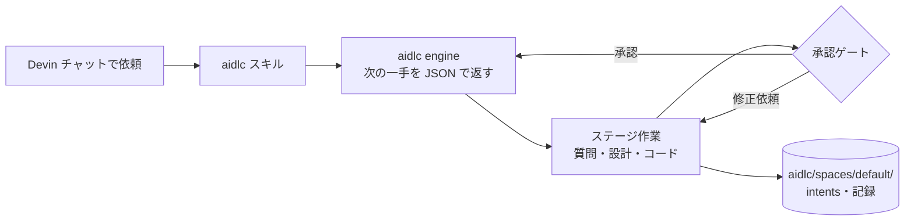

# aidlc

[AI-DLC v2](https://github.com/awslabs/aidlc-workflows)（AI-Driven Development Life Cycle、2.11.3）を Devin で動かすためのリポジトリ。

AI-DLC は「要件 → 設計 → 実装 → テスト → 運用」を段階（ステージ）に分け、各段階で人の承認を取りながら進めるワークフローです。決定事項・成果物・監査ログは `aidlc/` 配下に記録され、git で管理します。



## 構成

| パス | 内容 |
| --- | --- |
| `AGENTS.md` | AI-DLC の概要（`AI-DLC:agents` ブロックは `aidlc config` が管理）と Devin 向けの手順 |
| `.agents/skills/` | `aidlc` ほか各ステージ・スコープのスキル（Devin が自動で読み込む） |
| `.codex/` | エンジン一式（プロトコル・エージェント・センサー・スコープ・ツール） |
| `aidlc/spaces/default/` | ルール（`memory/`）、チーム知識（`knowledge/`）、作業記録（`intents/`） |

Devin 専用のハーネスはないため、Devin が読む `AGENTS.md` と `.agents/skills/` を使う Codex CLI ハーネスで設定しています。

## Devin での使い方

Devin のチャットで `@skills:aidlc` を付けて依頼します（`@` を入力して Skills から選べます）。Devin の Web アプリでは、スキルは `/aidlc` ではなく `@skills:<名前>` で呼び出します。

```text
@skills:aidlc 在庫管理の REST API を作って
```

`@skills:aidlc-express` のように、スコープやステージ別のスキルも同じ形で呼べます。

- Devin が `aidlc` スキルを起動し、計画の提案 → 質問 → 承認ゲートの順に進めます
- 承認・修正はチャットで返答するだけです
- 進捗確認: `@skills:aidlc --status`
- 軽量に進める: `@skills:aidlc-express 〇〇を作って`

## セットアップ（新しい環境）

```bash
curl -fsSL https://github.com/awslabs/aidlc-workflows/releases/latest/download/install.sh | sh
aidlc doctor
```

`aidlc doctor` の Codex フック未実行・`codex` 未インストールの警告は、Devin では Codex を使わないため無視して構いません。

更新は `aidlc update` の後に `aidlc config` を実行します（作業中のワークフローを終えてから）。
